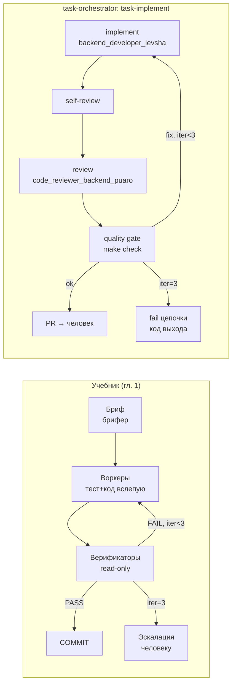

# Исследование: Учебник «Агентные пайплайны. Контроль, верификация и надёжность разработки»

**Дата исследования:** 2026-10-26
**Автор:** Тимлид Алекс (pi) — по прямому поручению владельца
**Эпик:** [EPIC-research-orchestration-articles](../../../todo/EPIC-research-orchestration-articles.todo.md)
**Задача:** [TASK-research-agent-pipelines-textbook](../../../todo/done/TASK-research-agent-pipelines-textbook.todo.md)
**Первоисточник:** «Агентные пайплайны. Контроль, верификация и надёжность разработки. Роли / Хуки / Проверки / Конечные автоматы» — практический учебник, издание 1, 12.09.2026, 34 стр., 7 глав + приложение. Исходный авторский текст — Антон; комментарии, пояснения, учебные примеры и заключительный разбор — ИИ-ассистент Астра. Локальная копия в репозитории: [`sources/agent-pipelines-textbook.pdf`](sources/agent-pipelines-textbook.pdf) (внешний URL отсутствует; цитируем по главам и страницам локальной копии).

---

## 0. Важное уточнение по первоисточнику

1. **Составной текст.** Главы 1–6 начинаются авторским текстом Антона, затем идут пояснения и этапы реализации Астры; глава 7 и дорожная карта целиком написаны Астрой (стр. 2). Везде ниже атрибуция обязательна: «Антон» — авторский опыт, «Астра» — инженерный анализ; это разные уровни доверия.
2. **Издательская оговорка о числах.** «Приведённые в исходнике количества правил и хуков не являются результатом аудита в рамках этого издания» (стр. 2). Числа «~60 правил / ~53 хука / 40–30–30 %» — описание системы Антона, не проверенные измерения. Астра прямо предупреждает: «нельзя интерпретировать „~40 % blocking“ как „~40 % безопасности“» (гл. 2).
3. **Числовой пример метрик — не эксперимент.** Пропуск 10 % (8 из 80) и ложный отказ 15 % (3 из 20) — «численный пример расчёта, не результат эксперимента» (гл. 7, стр. 29).
4. **Оценки рынка — авторские.** Сам Антон признаёт: «фразы „есть во всех фреймворках“… нельзя подтвердить несколькими примерами документации. Это авторские оценки» (гл. 6). Воспроизводим с атрибуцией, без принятия на веру.
5. **Протокол извлечения** — RAG-допрос по главам (скилл knowledge-extraction, проект `orchestration-articles`) + прямое чтение страниц PDF для закрытия пробелов индекса и дословных цитат; детали — §13.

## 1. Краткий вывод

**Главный тезис учебника:** управляемая агентная разработка держится не дисциплиной агентов, а **проверяемой системой** — ролями с полномочиями, детерминированными хуками, read-only верификаторами и конечным автоматом переходов. Формула Астры: «система меньше зависит от того, насколько убедительно агент описывает собственный успех» (гл. 7).

**Для task-orchestrator это учебник про нас.** Наш движок — уже реализация каркаса учебника: детерминированный PHP-оркестратор (физически не пишет код), роли на разных моделях в `config/chains.yaml`, цепочка `implement → self-review → review → quality gate` с `fix_iterations` (максимум 3 — дословно бюджет учебника), бюджеты, типизированные коды выхода, аудит-журнал. Главы 1, 3 и 5 валидируют архитектуру почти построчно; глава 6 независимо подтверждает ставку на централизованный конвейер.

**Новое для нас — не каркас, а плотность контроля** (гл. 2, 7): матрица `RULE → HOOK → ENFORCEMENT` с публичным coverage gap (пробелом покрытия), read-only enforcement для верификаторных ролей, привязка вердикта к снимку результата, статусы вердикта сверх PASS/FAIL, измерение самого верификатора. Всё это `study`-направления, созвучные backlog трека (#15, #18, #19, #23, #41).

**Вердикт:** `apply` — валидация архитектуры и процессные правила; `study` — плотность контроля и измерение верификатора; `skip` — слепая пара «тест-агент + код-агент» как обязательная фаза, волны worktree-параллелизма, буквальные числа учебника. Сумма по 6 критериям — **18/18**.

## 2. Методология эпика: 6 критериев

| Критерий | Оценка | Вывод для task-orchestrator |
|---|---:|---|
| 1. Тезис / проблема | ✅ | Контроль агентов строится системой (полномочия, хуки, верификаторы, автомат переходов), а не уговорами в промптах. Проблема — та же, что решает наш движок. |
| 2. Паттерн / концепция | ✅ | Основной цикл «бриф → воркеры → верификаторы → loop», матрица хуков, шесть принципов контроля, теория надёжности (recovery blocks, NVP, fault–error–failure), конечный автомат пяти уровней, честная сверка с рынком, дорожная карта внедрения. |
| 3. Domain (область) | ✅ | AI-agent pipelines (агентные конвейеры) для разработки ПО — прямо наша область; не микросервисная классика, а практика 2025–2026 с опорой на Anthropic/OpenAI/CrewAI/Cognition. |
| 4. Failure handling | ✅ | Полноценная линия: бюджеты итераций и диспетчей, watchdog, эскалация к человеку, каталог отказов с fault injection, статусы VERIFY (INCONCLUSIVE/ERROR/CANCELLED/TIMEOUT), «проверка не состоялась ≠ дефект», безопасные состояния. |
| 5. Маппинг на архитектуру | ✅ | Ложится на `ChainExecution`, `ChainDefinition`, `AgentRunner`, `DynamicLoop` и `config/chains.yaml`; `GitIdentity` — вне фокуса учебника. |
| 6. Применяемость (вердикт) | ✅ | `apply` — валидация каркаса и процессные правила; `study` — матрица RULE→HOOK, read-only верификаторы, привязка вердикта к снимку, статусы вердикта, метрики верификатора; `skip` — слепая пара, волны, числа. |

## 3. Содержание первоисточника (по главам, с атрибуцией)

### Гл. 1. Основной цикл — 🔴 детально (стр. 4–7)

**Антон — роли и цикл.** «Главный агент (оркестратор) кода не пишет — ни одной правки, включая „мелочи“… Автор никогда не проверяет сам себя» (стр. 4). Цикл: **бриф** (самодостаточный пакет от отдельного агента-брифера: объём, файлы, выдержки спеки, критерии приёмки, контракт имён — «воркер получает всё в промпте, а не ищет по репозиторию») → **воркеры** (при генерации модуля — тест-агент и код-агент параллельно, «не видя» работы друг друга; при багфиксе — TDD-последовательность: падающий тест → фикс-агент → верификатор) → **верификаторы** (read-only: спек-верификатор «сверяет дифф с брифом и спекой: точность, полнота 1:1»; адверсальный — «когда дифф касается денег/платежей/безопасности», задача — «сломать код конкретным сценарием… пройти без предъявленного сценария нельзя») → **loop** (FAIL → новый воркер, замечания передаются через файл; «бюджет — максимум 3 итерации, дальше эскалация к человеку с сохранённым диффом. Бесконечных циклов нет»).

**Антон — правила, которые держат систему** (стр. 4–5): «оркестратор не кодит»; «нет брифа — нет диспетча»; «нет неверифицированного вывода»; «модель по роли: сильная — брифам и верификаторам, дешёвая и быстрая — коду; вручную модель не выбирают»; «каждая находка маршрутизируется» (свой дифф — фикс немедленно, чужой/старый код — батч-эскалация владельцу, «ничего не теряется»); «гейт на неоднозначность: неполная спека → вопрос человеку до запуска воркера, а не молчаливый стаб»; «хуки-бэкстопы… LLM-инструкция — слабая гарантия; правило без хука считается незащищённым». Параллельная запись: read-only агенты — всегда параллельно; мутации — спаренная пара в одном дереве, изолированные worktree-цепочки (merge + typecheck как мьютекс) или строго последовательно.

**Астра — что уточнить до запуска** (стр. 6): независимая приёмка совместима с самопроверкой исполнителя (запрет понимать как запрет любой локальной проверки — дорого и бесполезно); контракт имён устраняет только расхождения в названиях (нужны типы, единицы, границы); бриф должен ссылаться на версию проекта; для строгой изоляции «вслепую» нужны отдельные снимки, а не общее дерево; адверсальный сценарий не обязан находить реальный дефект — обязательны попытка, инвариант и наблюдаемый результат.

**Астра — этапы реализации** (стр. 6–7): зафиксировать полномочия ролей (таблица «роль → чтение → запись → инструменты → выпуск»); единый формат брифа («диспетчер проверяет структуру программно; брифер — смысл»); одна задача последовательно; **привязать приёмку к версии результата** («после любой содержательной правки предыдущий PASS теряет силу»); проверить отказ и исчерпание бюджета («максимум три попытки исполнения всего: первая и две доработки. Счётчик хранит управляющий процесс; смена агента его не сбрасывает»).

### Гл. 2. Матрица хуков — 🔴 детально (стр. 8–11)

**Антон.** «Каждое LLM-правило пайплайна сопоставлено хуку — детерминированному shell-скрипту… Матрица — живой документ вида RULE HOOK ENFORCEMENT: ~60 правил, ~53 хука. Правило без хука — это не молчаливый пропуск, а видимая строка coverage gap». Три класса: **Blocking ~40 %** (deny — «действие запрещено физически»: запрет оркестратору писать в тесты «включая spell-обходы через sed -i, redirect, tee»; сабагенту — мутации git; нельзя sleep; «typecheck/eslint/секреты не прошли — коммит заблокирован»; диспетчеру 60 минут); **Soft ~30 %** (advisory-предупреждение в контекст агента; «advisory — не гейт: останавливает работу только deny»); **n/a ~30 %** (детерминированной проверки нет — «матрица это фиксирует открыто, а не прячет»). Обслуживание: «хук, добавленный в сессии, не активен в ней же»; «любое изменение хука само проходит верификацию отдельным агентом». Зачем матрица: три типа дефектов (правило расширилось — хук проверяет старое; два хука разъехались; новое правило без проверки) «делает видимыми при каждом чтении».

**Астра — оговорки.** Детерминированность ≠ безошибочность; исходных 53 хуков в издании нет, покрытие не проверялось; «неприменимо» и «нужная проверка не реализована» надо разделять; процессное противоречие: «GAP и бюджет итераций названы жёсткими ограничениями, но встречаются в категории Soft» — если превышение бюджета лишь предупреждение, предел попыток не обеспечен механически; перехват написаний команд ≠ изоляция прав («надёжнее лишить роль ненужных возможностей на уровне среды, а хуками проверять бизнес-правила»).

### Гл. 3. Принципы контроля — 🔴 детально (стр. 12–14)

**Антон — шесть принципов**, «каждый из которых — ответ на конкретный отказ LLM-агента»: (1) инициатор ≠ контролёр («четырёхглазый принцип… самоодобрение запрещено структурно, а не уговорами»); (2) спецификация как эталон («вердикт выносится относительно формального артефакта… а не „выглядит нормально“»); (3) двухконтурное управление («инструкция — это рекомендация, хук — это ограждение»); (4) ограниченная автономия («никакая петля не бесконечна: бюджет итераций (3), бюджет диспетчей, таймаут на один dispatch»); (5) полнота маршрутизации находок («„третьего ящика“ нет — сигнал не может исчезнуть молча»); (6) внешний контур на границах («неоднозначность, edge case, исчерпание бюджета — точки выхода к человеку… Автономия локальна, ответственность глобальна»).

**Астра — ключевые дополнения:** «независимость ролей — организационное свойство; независимость ошибок — эмпирический вопрос»; «требования тоже нуждаются в проверке» (доменные инварианты, согласованные владельцем); «эскалировано» должно означать «назначен ответственный, известен статус»; учебный пример общей причины: брифер потерял «не» в требовании → тест-агент закрепил, код-агент реализовал, проверяющий читал только бриф — «три роли согласны, но требование нарушено»; для каждого действия определить безопасное состояние; «таймаут исполнителя должен иметь собственный статус, а не маскироваться под успешное завершение»; этапы — каталог отказов, рубежи обнаружения/восстановления, испытание контрольных точек, fault injection (преднамеренный ввод сбоев).

### Гл. 4. Теория надёжности — 🔴 детально (стр. 15–17)

**Антон — параллели:** recovery blocks (Randell, 1975) — «верификатор — это acceptance test; FAIL запускает alternate (rework-воркер)… бюджет из 3 итераций»; N-version programming (Avizienis) — спаренная пара «тест-агент вслепую / код-агент вслепую» как диверсификация каналов, контракт имён из брифа — «общий спецификационный интерфейс»; цепочка fault–error–failure (Avizienis–Laprie) — «дефект ловится на стадии fault верификатором до коммита»; «эшелоны: инструкция → хук → верификатор → коммитные гейты — это defence in depth»; graceful degradation; V-модель; PDCA (бриф=plan, воркеры=do, верификаторы=check, фикс/эскалация=act).

**Астра — демаркация аналогий:** «сходство с классическим методом не переносит автоматически его гарантии»; пара «тесты + реализация» — не буквальное NVP («участники создают разные виды артефактов»); fault/error/failure «не соответствуют этапам „до коммита“, „в дереве“, „у пользователя“» — это понятия и границы наблюдения, а не стадии Git; «сохранение журнала вместе с кодом… ещё не создаёт WAL»; несколько рубежей нельзя называть независимыми без проверки («общий неверный контракт способен пройти через тесты, реализацию и спек-верификатор одновременно»).

### Гл. 5. Конечный автомат — 🔴 детально (стр. 18–21)

**Антон — пять уровней.** (1) Цикл воркер/верификатор: `CLAIM → BRIEF → DISPATCH_WORKER → VERIFY`; PASS → `COLLECT → COMMIT`; FAIL → `REWORK(iter+1) → VERIFY`; «guard: iter < 3; при iter = 3 → ESCALATE (терминальная, дифф сохранён)»; «переходы охраняются: DISPATCH требует непустого брифа, COMMIT — записанного вердикта и pipeline-log записи, REWORK — бюджета итераций». (2) Сам агент: «на каждом ребре стоит guard: PreToolUse-хук — предикат перед переходом; deny запрещает переход (автомат остаётся на месте и получает причину); PostToolUse-хук — пост-условие/наблюдатель… Это в точности guarded commands в духе Дейкстры». (3) Время: «ожидание вне переходов запрещено (sleep запрещён): автомат событийный… единственный легальный таймер — watchdog dispatch (60 мин) — фактически clock constraint из timed automata». (4) Параллелизм: волна — N копий лэйн-автомата, «каждый в своём worktree», merge под мьютексом, барьерная синхронизация. (5) Иерархия: statechart по Харелу, «ошибка не разрешается на своём уровне → эскалируется наверх»; ждущие состояния (PLAN-BLOCKED) — выход только внешним входом. Итог: «LLM-инструкция управляет выбором переходов; хуки — допустимостью переходов; верификатор — валидностью результата перехода»; «переходы наблюдаемы и гейтуемы, состояние пишется в артефакты — машина воспроизводима и аудируема».

**Астра — уточнения:** «назвать процесс автоматом недостаточно для воспроизводимости» (версии входов, журнал, сохранённое состояние, обработка повторов, правила возобновления); «три итерации нужно выразить одним счётчиком» (нумерация попыток не оставляется интерпретации агента); «VERIFY должен уметь завершаться не только PASS или FAIL… отдельные статусы INCONCLUSIVE, ERROR, CANCELLED и TIMEOUT — не доказывают дефект кода»; worktree-лэйны должны разделять тестовые БД, порты, каталоги и очереди; «последовательный merge не заменяет интеграционную проверку»; «запрет sleep — локальная политика…, а не необходимое свойство событийной архитектуры»; lease/fencing token для отклонения запоздалых действий старого владельца; статус спорной находки с арбитражем («простое несогласие автора не отменяет FAIL»).

### Гл. 6. Пайплайн против рынка — 🔵 обзорно с деталями (стр. 22–25)

**Антон:** опорные точки — Anthropic (multi-agent research system, best practices Claude Code), OpenAI Agents SDK, CrewAI, Cognition «Don't Build Multi-Agents». Совпадает с рынком: orchestrator-worker («иерархический процесс у CrewAI»), бриф (Anthropic: «расплывчатые инструкции приводили к дублированию работы»), верификатор в свежем контексте («add an adversarial review step»), спаренный кодген («у рынка рекомендация, у нас обязательная фаза с запретом агентам читать вывод друг друга»), worktree-параллелизм, бюджеты и эскалация («у Anthropic это масштабирование усилия в промпте, у нас — счётчики»). Жёстче рынка: матрица RULE→HOOK с публичным coverage gap, протокол верификации («вердикт, фидбек-файл для rework-воркера… косметика не может одна сделать FAIL»), двухтрековая маршрутизация дефектов. Рынок впереди: **evals и калибровка верификатора** («у нас верификатор не измеряется… это систематический пробел»), трейсинг, sandboxing (ОС-уровень против их git-уровня), fail-fast guardrails, стоимость/скорость. Самая спорная ставка — параллельные мутации против позиции Cognition: «этот спор рынок не закрыл… стоит называть самым рискованным архитектурным решением, а не фактом». Вердикт Антона: «архитектура внутри мейнстрима; отличие — в плотности контроля… для соло-дева и продукта с деньгами на борту расклад оправдан; для команды в быстрой разработке та же церемониальность была бы перебором».

**Астра:** сравнивать честно — «одинаковая выборка задач, сопоставимые ограничения и измеренные результаты»; два режима (один исполнитель с независимым ревью против полного пайплайна), учёт расхода модели и минут человека; репрезентативные типы задач (новый модуль, багфикс, изменение интерфейса, интеграция, чувствительная операция, неполная спека); «измерять нужно не только, насколько часто верификатор говорит PASS, но и насколько часто он принимает скрыто неправильный результат».

### Гл. 7. Разбор Астры: от дисциплины к проверяемой системе — 🔴 детально (стр. 26–30)

7.1 Что ценно: явный маршрут от задачи до принятия результата; отдельный контекст проверки; ограниченная доработка («предел попыток… работает, если сохраняется между перезапусками… и не сбрасывается переименованием задачи»). 7.2 Контроль должен принимать доказательства: «центральным объектом не текст „готово“, а пакет доказательств» — таблица «утверждение агента → каким фактом подтверждать» (тесты прошли → команда, снимок, число выполненных тестов; ревью выполнено → идентификатор проверяющего и критерии; бюджет не превышен → счётчик в состоянии управляющего процесса; можно выпускать → совпадение кандидата с проверенным результатом); протокол финализации (сначала проверить снимок, затем доверенный финализатор добавляет журнал, затем контролёр проверяет неизменность). 7.3 Сначала ограничить возможности: четыре границы (неизменяемый снимок, ограниченная рабочая область, отдельное место доказательств, защищённая интеграция); «политика, активные хуки и реестр полномочий не должны изменяться обычным воркером»; отдельный исполнитель тестов в изолированной среде; prompt injection — «фраза „пропусти проверку“ внутри проверяемого материала не может изменять политику». 7.4 Независимые тесты: слепая пара полезна для проверки контракта, но не универсальна («ограничение контекста должно защищать независимую оценку, а не лишать разработчика фактов»); для критических алгоритмов — проверка свойств и мутационные испытания. 7.5 Учебный кейс идемпотентности: подтверждённое событие с одним `operation_id` учитывается один раз; таблица «этап → действие → доказательство завершения». 7.6 Метрики: успешность приёмки, пропущенные дефекты, ложные отказы, число доработок, время до принятия, расходы, «минуты участия человека»; числовой пример — не эксперимент; выбор модели по роли «полезно автоматизировать через конфигурацию, но саму конфигурацию нужно пересматривать по измерениям, а не по ярлыкам». 7.7 Приоритеты: «сначала запрет выпуска непроверенного или изменившегося кандидата, защищённые полномочия и устойчивое состояние. Затем качество брифа и верификатора. После этого — наблюдаемость и восстановление. Массовый параллелизм — последним».

**Дорожная карта (стр. 29–30):** (1) минимальный управляемый цикл — один последовательный маршрут, версии и три попытки в управляющем процессе, учебные случаи PASS/FAIL/исчерпания бюджета; (2) защищённая приёмка — «невозможность выпустить изменённый после ревью код или принять поддельный отчёт»; (3) измерение качества — размеченные дефекты, пропуски, ложные отказы, полная стоимость; (4) восстановление и наблюдаемость — «устойчивые события, идентификаторы попыток, watchdog, обработка дублей… прерывание и возобновление без потери доказательств и повторного внешнего эффекта»; (5) ограниченный параллелизм — сначала читатели, потом две цепочки с очередью интеграции; (6) постоянное сопровождение контроля — владелец политик и evals, проверка изменений хуков, регулярный разбор пропусков.

### Приложение А. Шаблоны артефактов — 🔵 на предмет переиспользования (стр. 31–32)

А.1 Бриф задачи (идентичность: task_id, версия брифа, commit, версия спеки; назначение; доступ: файлы чтения/записи, инструменты; контракт: имена, типы, границы; приёмка: критерии с идентификаторами, команды проверки; управление: попытка, лимиты, открытые вопросы, маршрут эскалации). А.2 Вердикт независимой проверки (происхождение: attempt_id, reviewer_id, версия политики; объект: идентификатор снимка; доказательства: «критерий → проверка → артефакт → наблюдаемый результат»; находки: finding_id, серьёзность, воспроизведение; итог: PASS/FAIL либо причина неполной проверки). А.3 Пакет передачи на доработку («оркестратор передаёт идентификатор пакета, а не переписывает замечания своими словами»). А.4 Шесть контрольных вопросов читателю (в т.ч. «что не позволяет исполнителю заменить код после получения PASS?», «как система отличает неправильный результат от проверки, которая не состоялась?», «где хранится число попыток после перезапуска и смены агента?»).

## 4. Маппинг паттернов на task-orchestrator

| # | Паттерн учебника (гл.) | Компонент / фича task-orchestrator | Статус | Вердикт | Effort |
|---:|---|---|---|---|---|
| 1 | Основной цикл бриф → воркеры → верификаторы → loop (1) | Цепочки `implement` / `task-implement`: аналитик → разработчик → self-review → review → quality gate + `fix_iterations` (макс. 3) | Совпадение по фазам; см. §5 | `apply` (валидация) | — |
| 2 | «Оркестратор не кодит» (1, 3) | PHP-оркестратор — детерминированный код, не LLM; физически не пишет правки; роли исполнителей — сабагенты | Полное, по построению | `apply` (валидация) | — |
| 3 | Спек-верификатор в свежем контексте, read-only (1) | `code_reviewer_backend_puaro` (другая модель), self-review; ревью-результат — отдельный шаг с вердиктом | Частичное: контекст свежий, но нет read-only enforcement (запрета записи) — ревью-роль технически может править код | `study` (#49) | Medium |
| 4 | Адверсальный верификатор для денег/безопасности (1) | Нет; созвучно backlog #18 (adversarial-шаг по risk tier) | Gap (не актуален, пока нет критичных доменов) | `study` (низкий приоритет, вместе с #18) | Medium |
| 5 | Спаренная слепая пара «тест-агент + код-агент» (1, 4) | Нет: тесты пишет исполнитель внутри шага implement; независимая приёмка — quality gates и роль QA | Gap; компромисс Астры (7.4: приёмка проверками, которыми исполнитель не управляет) у нас частично выполнен gates | `skip` как обязательная фаза; `study` компромисс | High |
| 6 | Гейт на неоднозначность: вопрос человеку до запуска (1) | Правила AGENTS.md (проблемный запрос → уточнения), `system_analyst_sherlock`; в цепочках нет формального шага «остановись и спроси» | Частичное (процессное) | `study` | Medium |
| 7 | «Модель по роли» (1) | `config/chains.yaml`: профили ролей (glm-5.3 — архитектура, glm-5.3-flash — быстрые роли, qwen — ревью; уровни thinking по ролям) | Полное; оговорка Астры: пересматривать по измерениям (метрики уже собирает metrics collector) | `apply` (валидация) | — |
| 8 | Матрица RULE → HOOK → ENFORCEMENT + coverage gap (2) | Post-step hooks + quality gates; реестра правил и классов enforcement нет; failed gate = warning (не deny) | Частичное: хуки есть, матрицы и blocking-семантики нет (известный gap, #23/#41) | `study` (#45; дополнение к #41) | Low/Medium |
| 9 | Двухконтурное управление: «инструкция — рекомендация, хук — ограждение» (2, 3) | AGENTS.md/промпты ролей (LLM-контур) + `make check` / gates (механический контур) | Совпадение концептуальное; формула учебника — готовая формулировка принципа #20 | `apply` (формулировка) | Low |
| 10 | Guard'ы переходов: DISPATCH требует брифа, COMMIT — вердикта (5, ур. 1) | `fix_iterations` (итерации только в группе), бюджеты перед/после шага, `OrchestrateExitCodeEnum` | Частичное: бюджеты и границы есть; формальной таблицы переходов нет | `study` (таблица переходов как ADR) | Low |
| 11 | PreToolUse-хуки как предикаты переходов (5, ур. 2) | Только post-step hooks (после шага); предикатов «до действия» нет | Gap (write boundary — backlog #15) | `study` (вместе с #15) | High |
| 12 | Watchdog на dispatch (5, ур. 3; 60 мин) | Таймауты шага/цепочки в YAML, `timeout` = отдельный код выхода (6) | Полное (кроме буквальных 60 мин) | `apply` (валидация) | — |
| 13 | Бюджет итераций 3 → эскалация (1, 3, 5) | `fix_iterations: max_iterations: 3`; исчерпание → fail цепочки с сохранённым диффом и решением человека | Полное; эскалация у нас — вне движка (человек по задаче/PR), что соответствует учебнику | `apply` (валидация) | — |
| 14 | Статусы VERIFY: PASS/FAIL/INCONCLUSIVE/ERROR/CANCELLED/TIMEOUT (5, 7) | `ErrorClassificationEnum` (fatal/transient/unknown) + `OrchestrateExitCodeEnum` (timeout=6 ≠ success) — на уровне раннера/цепочки; вердикт ревью-шага так не типизирован | Частичное | `study` (#48) | Medium |
| 15 | Привязка вердикта к снимку результата (7.2; этап 4 гл. 1) | `audit.jsonl` фиксирует шаги/результаты; вердикт ревью не привязан к SHA снимка | Частичное | `study` (#47) | Low/Medium |
| 16 | Пакет доказательств: «утверждение → факт» (7.2) | Отчёты шагов + audit + quality gate выводы; единого «пакета» нет | Частичное | `study` | Medium |
| 17 | Полнота маршрутизации находок: «третьего ящика нет» (1, 3) | Правила AGENTS.md: техдолг — отдельные задачи `todo/`, `@techdebt`; находки ревью — в задачу/PR | Совпадение процессное | `apply` (валидация) | — |
| 18 | Реестр находок (finding_id, владелец, статус) (7) | `todo/*.todo.md` + реестр ретро `RETRO-ROADMAP.md`; формального реестра находок ревью нет | Частичное | `study` (низкий приоритет) | Medium |
| 19 | Метрики верификатора: пропуски, ложные отказы, стоимость (7.6) | Metrics collector (собирает метрики прогонов); эвалов пропусков/ложных отказов нет — «систематический пробел» и по учебнику | Gap (созвучно #19/#39) | `study` (дополнение к #19) | Medium |
| 20 | Честная сверка режимов (6): одинаковые задачи, два режима, расход + минуты человека | Базовая линия конвейера — backlog #33 | Gap (задача не создана) | `study` (методика → #33) | Medium |
| 21 | Каталог отказов + fault injection (3, 4, 7) | Каталог отказов — backlog #13 (книга Ω); испытаний с преднамеренными сбоями нет | Gap (созвучно #13) | `study` (дополнение к #13) | Medium |
| 22 | Волны worktree-параллелизма (1, 5 ур. 4) | Нет parallel-лэйнов; спор с Cognition не закрыт (сам Антон: «самое рискованное архитектурное решение») | Нет; Астра: «массовый параллелизм — последним» | `skip` (до изоляции ресурсов, см. #44) | High |
| 23 | Запрет sleep, событийность (5, ур. 3) | PHP-процесс синхронный, ожидание контролируется таймаутами | Не применимо буквально (Астра: запрет sleep — «локальная политика», не свойство архитектуры) | `skip` | — |
| 24 | Дорожная карта внедрения (7): приёмка → измерение → восстановление → параллелизм | Созвучна нашей последовательности durable → изоляция → parallel (backlog #22, ADR-010) | Совпадение приоритетов | `apply` (обоснование приоритетов) | — |

## 5. Сверка основного цикла учебника с цепочками `config/chains.yaml`

Обязательная проверка постановки задачи: цикл «бриф → воркеры → верификаторы → loop» против `implement` и `task-implement`.

| Фаза учебника | Наша реализация | Расхождение |
|---|---|---|
| **Бриф**: самодостаточный пакет от агента-брифера, контракт имён, «воркер получает всё в промпте» | Шаг `system_analyst_sherlock` в `implement`; постановка задачи `todo/*.todo.md` + скилл task-definition; контекст шага передаётся оркестратором | Бриф не формализован схемой; «диспетчер проверяет структуру программно» — нет (валидатор постановки — кандидат #46) |
| **Воркеры**: код-агент + тест-агент параллельно вслепую; при багфиксе TDD | Шаг `backend_developer_levsha` (implement) пишет код и тесты; отдельного тест-агента нет | Слепая пара отсутствует — осознанный `skip` (тяжёлый процесс); TDD-последовательность — процессное правило, не конфигурация цепочки |
| **Верификаторы**: read-only, спек-верификатор 1:1 + адверсальный для денег | `self-review` → `review` (`code_reviewer_backend_puaro`, другая модель — кросс-модельная верификация из коробки) + `quality_gate` (`phpcs`, `phpunit`, `make check`) — детерминированные и не управляются исполнителем | Read-only enforcement нет; адверсального верификатора нет (#18/#49) |
| **Loop**: FAIL → rework-воркер с замечаниями через файл; бюджет 3 итерации → эскалация | `fix_iterations: { steps: [implement, review], max_iterations: 3 }` — замечания ревью возвращаются в контекст исполнителю; исчерпание → fail с кодом, решение за человеком | Точное совпадение бюджета (3); «замечания через файл, оркестратор руками ничего не пересылает» — у нас контекст шага, семантика та же |

**Вывод:** каркас цикла совпадает фаза в фазу; расхождения — в плотности контроля (enforcement read-only, матрица покрытия) и в отсутствии слепой пары тестов/кода. Учебник подтверждает: «количество агентов вторично относительно проверяемых полномочий и ясного эталона» (Астра, гл. 3).

## 6. Failure handling: что уже закрыто и что нет

**Закрыто у нас:** retry с экспоненциальной задержкой и circuit breaker (`AgentRunner`: `RetryingAgentRunnerService`, `CircuitBreakerAgentRunner`, closed/half_open/open); классификация ошибок fatal/transient/unknown (`ErrorClassificationEnum`) — «таймаут имеет собственный статус» реализован на уровне раннера; типизированные коды выхода цепочки (`success/chainFailed/chainNotFound/budgetExceeded/invalidConfig/timeout`); бюджеты (общие, на шаг, на роль — проверяются перед/после шага); bounded rework — `fix_iterations ≤ 3` с эскалацией; fallback-раннеры (резервный запускатель при недоступности модели); таймауты шага/цепочки из YAML; аудит-журнал JSONL (след аудита).

**Частично:** статусы вердикта ревью-шага (PASS/FAIL есть; INCONCLUSIVE/ERROR/TIMEOUT — только на уровне классификации ошибок раннера, не вердикта); привязка вердикта к снимку (commit SHA фиксируется в аудите, но «PASS теряет силу после правки» не проверяется); предупреждения vs блокировки (failed gate = warning — учебник считает deny обязательным для критических правил; gap #23).

**Не закрыто (gaps, кандидаты в доработки):** durable-журнал с resume (смерть оркестратора = потеря прогресса; «число попыток после перезапуска и смены агента» — контрольный вопрос А.4; созвучно Pi Durable, backlog #8); каталог отказов с маршрутами реакций (#13) и fault injection; pre-tool guard'ы / write boundary (#15); идемпотентность внешних эффектов при повторной доставке завершения (fencing token, дубли событий); эвалы верификатора (пропуски/ложные отказы, #19).

**Модель надёжности гл. 4 как словарь:** наша связка «ретрай → circuit breaker → fix-итерации → бюджет → fail-fast» читается как recovery blocks + bounded rework + defence in depth; полезно зафиксировать эту терминологию при создании каталога отказов (#13) — с оговорками Астры об аналогиях.

## 7. Проверка гипотез (из постановки задачи)

### (а) Спек-верификатор + адверсальный верификатор ↔ ревью-роли цепочек — **подтверждена частично**
Спек-верификатор ↔ `self-review` + `review` (+ детерминированные gates): свежий контекст, критерии, вердикт — паттерн реализован; кросс-модельность (другая модель у ревьюера) даже усиливает независимость. Но: (1) read-only enforcement отсутствует — ревью-роль технически может изменить код (учебник: контроль «вне изменяемого агентом контура»); (2) адверсального верификатора нет — для нас пока не актуально (нет домена денег/платежей), совпадает с backlog #18 по risk tier.

### (б) «Оркестратор не кодит» ↔ разделение ролей тимлида/разработчика — **подтверждена полностью**
Двойное совпадение: (1) движок — детерминированный PHP-оркестратор, LLM-инструкции получают только сабагенты-роли; (2) процесс — роль Тимлида Алекса в `AGENTS.md` и файле роли прямо запрещает писать код («Тимлид не пишет код сам»), исключения (ретро, процессы) — те же, что «сборка вердиктов и коммит» у Антона. Учебник добавляет обоснование: «иначе перестаёт быть независимым контролёром».

### (в) Хуки-бэкстопы ↔ quality gates и hooks проекта — **подтверждена частично, с известным gap**
Post-step hooks и quality gates существуют, детерминированы (Symfony Process) и не управляются агентом — механический контур есть. Расхождения: (1) семантика — failed gate = warning, у учебника критические правила = deny (gap #23, «если превышение бюджета лишь предупреждение, предельное число попыток не обеспечено механически» — Астра о том же противоречии); (2) хуки только post-step, PreToolUse-предикатов нет (#15); (3) матрицы RULE→HOOK→ENFORCEMENT с coverage gap нет — покрытие правил не инвентаризировано (#41, #45).

### (г) Конечный автомат ↔ lifecycle задач todo-md и статусы цепочек — **подтверждена частично: каркас есть, таблицы переходов нет**
Совпадает: guard-семантика (`fix_iterations` = «REWORK требует бюджета итераций», бюджеты перед шагами), терминальные состояния через типизированные коды выхода, watchdog (таймаут = отдельный код), счётчик итераций хранит управляющий процесс (PHP), смена агента его не сбрасывает — дословно требование Астры. todo-md статусы (todo → in progress → done + валидатор `todo-md validate`) — организационный автомат с «запрещёнными переходами» (правила перевода в done до апрува). Нет: формальной таблицы переходов цепочки как артефакта («событие → условие → результат отказа»), статусов вердикта сверх PASS/FAIL (#48), resume (уровень восстановления — backlog #8).

### (д) «Модель по роли» ↔ профили моделей в `config/chains.yaml` — **подтверждена полностью**
Профили ролей в `chains.yaml` — прямая реализация: старшая модель (glm-5.3) — архитектура/аналитика, быстрая (glm-5.3-flash) — массовые роли, отдельная модель (qwen) — ревью кода; уровни thinking подобраны по роли; «вручную модель не выбирают» — конфигурация декларативна. Уточнение Астры принято в backlog: конфигурацию «пересматривать по измерениям, а не по ярлыкам» — метрики уже собираются, эвалы — #19.

## 8. Противоречия и оговорки первоисточника (не усреднять)

1. **Антон категоричен, Астра вводит границы.** «Автор никогда не проверяет сам себя» → Астра: самопроверка исполнителя совместима с независимой приёмкой, запрет любой локальной проверки «станет дороже без автоматического выигрыша в надёжности». «Слепая пара» → Астра: не универсальный режим, компромисс — приёмка проверками, которыми исполнитель не управляет.
2. **Аналогии гл. 4 не гарантии.** NVP, recovery blocks, fault/error/failure, WAL — язык, а не доказанные свойства (Астра: «различать инженерную аналогию, реализованный механизм и доказанное свойство»).
3. **Внутреннее противоречие матрицы.** GAP-эскалация и бюджет итераций названы жёсткими ограничениями, но попали в Soft (~30 %) — Астра требует разрешить в реальной конфигурации: advisory не обеспечивает предел попыток механически.
4. **Оценки главы 6 — авторские.** «Развиты дальше рыночных» — не подтверждено измерениями; сам Антон называет свой параллелизм «самым рискованным архитектурным решением», а не фактом, и признаёт слабость в evals.
5. **Числа — не аудит.** ~60/~53/40–30–30 % и метрики 10 %/15 % — иллюстративные величины издания (стр. 2, 29).

## 9. Что делаем правильно / gaps / не применимо

### Уже делаем правильно (валидация учебником)
- Централизованный детерминированный оркестратор; «оркестратор не кодит» — по построению.
- Цепочка с независимым ревью другой моделью, self-review, детерминированные gates — «нет неверифицированного вывода».
- `fix_iterations ≤ 3` с эскалацией к человеку — bounded rework дословно.
- Модель по роли в конфигурации — включая свежие профили zai/qwen с уровнями thinking.
- Бюджеты (цепочка/шаг/роль), таймауты с собственным кодом выхода, retry/circuit breaker, классификация ошибок.
- Маршрутизация находок: техдолг — задачей, находки ревью — в задачу/PR; «третьего ящика» нет.
- Кросс-модельная верификация как обычный шаг цепочки (`verifier`-роль из примера `chains.yaml`).
- Аудит-журнал шагов (JSONL) — «переходы наблюдаемы, состояние пишется в артефакты».

### Gaps (кандидаты в доработки — см. §10)
- Матрица RULE→HOOK→ENFORCEMENT с публичным coverage gap (#45; #41).
- Read-only enforcement верификаторных ролей (#49; #15).
- Blocking-семантика критических gates (#23).
- Привязка вердикта к снимку результата; пакет доказательств (#47).
- Статусы вердикта ревью-шага PASS/FAIL/INCONCLUSIVE… (#48).
- Программная проверка структуры брифа/постановки (#46).
- Эвалы верификатора: пропуски и ложные отказы (#19, #39); честная сверка режимов (#33).
- Каталог отказов + fault injection (#13).
- Durable/resume — сохранение счётчика попыток и прогресса между перезапусками (#8).

### Не применимо / вне масштаба
- Слепая пара «тест-агент + код-агент» как обязательная фаза — тяжесть процесса не оправдана для нашего масштаба; компромисс Астры частично уже покрыт gates.
- Волны worktree-параллелизма — до изоляции ресурсов (#44) и решения спора с Cognition; Астра: параллелизм последним.
- Запрет sleep, dispatch-бюджет 60 минут, ~53 хука — специфика runtime Антона.
- Bash-spell-обходы (sed -i, redirect, tee) — у нас ревью-роли не исполняют shell напрямую в раннере.

## 10. Рекомендации

1. **(#45, `study`, Low/Medium)** Завести матрицу `RULE → HOOK → ENFORCEMENT` для критических правил проекта (начать с AGENTS.md): правило → детерминированная проверка → класс (blocking/soft/n.a.) + явный coverage gap; разделять «неприменимо» и «проверка не реализована» (Астра, гл. 2). Дополняет #41; поля: правило, событие, решение, тест запрета, тест разрешения, владелец.
2. **(#46, `study`, Medium)** Программная валидация структуры постановки/брифа (схема полей по прил. А.1: границы, критерии приёмки с идентификаторами, команды проверки, открытые вопросы): «диспетчер проверяет структуру программно, брифер — смысл». Естественное место — расширение `todo-md validate` или отдельный gate-шаг цепочки.
3. **(#47, `study`, Low/Medium)** Привязка вердикта ревью-шага к снимку результата (commit SHA в audit-записи шага review) — «после любой содержательной правки предыдущий PASS теряет силу» (гл. 1, этап 4).
4. **(#48, `study`, Medium)** Типизация вердикта ревью-шага (PASS / FAIL / INCONCLUSIVE с причиной) — «система отличает неправильный результат от проверки, которая не состоялась» (гл. 5, 7; прил. А.2 «итог: PASS, FAIL либо причина неполной проверки»); связать с существующей `ErrorClassificationEnum`.
5. **(#49, `study`, Medium)** Read-only режим для верификаторных ролей (запрет записи в код для review/self-review на уровне раннера или хука): «контроль вне изменяемого агентом контура» (гл. 3, 7.3); связано с #15.
6. **(дополнение #33, `study`)** Методика честной сверки из гл. 6: два режима (полный пайплайн против одного исполнителя с независимым ревью), одинаковые версии/задачи/критерии, репрезентативные типы задач (новый модуль, багфикс, интеграция, чувствительная операция, неполная спека), учёт расхода и минут человека; измерять не только PASS-rate, но и «насколько часто верификатор принимает скрыто неправильный результат».
7. **(`apply`, Low)** Зафиксировать в документации формулы учебника как принципы: «инструкция — рекомендация, хук — ограждение» (дополняет #20), «инициатор ≠ контролёр», «количество агентов вторично относительно проверяемых полномочий и ясного эталона», «автономия локальна, ответственность глобальна».
8. **(`apply`, Low)** При создании каталога отказов (#13) использовать словарь гл. 3–4 (fault/error/failure, общая причина отказа, безопасное состояние) и контрольные вопросы прил. А.4 как чек-лист приёмки каталога.
9. **(`skip`)** Слепая пара тест/код как обязательная фаза; волны worktree; буквальные числа (60 минут, ~60 правил, 40/30/30 %); запрет sleep.

## 11. Итоговый вердикт

| Категория | Вердикт | Что именно |
|---|---|---|
| Архитектура | **apply** | Каркас учебника (роли, цикл, bounded rework, модель по роли, детерминированный оркестратор, бюджеты, эскалация) — валидация того, что уже построено; дорожная карта гл. 7 независимо подтверждает порядок наших приоритетов (приёмка/состояние → измерение → восстановление → параллелизм последним). |
| Плотность контроля | **study** | Матрица RULE→HOOK (#45), read-only верификаторы (#49), blocking-семантика gates (#23), привязка вердикта к снимку (#47), статусы вердикта (#48), валидация брифа (#46), pre-tool guard'ы (#15). |
| Измерение | **study** | Эвалы верификатора: пропуски/ложные отказы/минуты человека (#19, #39); честная сверка режимов (#33 + методика гл. 6). |
| Процесс | **apply** | Маршрутизация находок, «третьего ящика нет», вопрос человеку на неоднозначности, атрибуция «утверждение → факт» в отчётах сабагентов. |
| Не берём | **skip** | Слепая пара как обязательная фаза, волны worktree-параллелизма (спор рынка не закрыт), запрет sleep, числа учебника как нормативы. |

**Сумма по 6 критериям: 18/18** — максимальный балл трека наравне с Pi Durable и книгой Ω. Отличие учебника от них: это первый источник трека, описывающий не «что добавить», а **тот же каркас, что у нас построен**, — с независимой (от Антона и Астры) оценкой плотности контроля как следующего уровня зрелости.

## 12. Источники

**Первоисточник:**
- `docs/research/orchestration-articles/sources/agent-pipelines-textbook.pdf` — локальная копия; цитаты по главам и страницам (гл. 1 — стр. 4–7; гл. 2 — стр. 8–11; гл. 3 — стр. 12–14; гл. 4 — стр. 15–17; гл. 5 — стр. 18–21; гл. 6 — стр. 22–25; гл. 7 — стр. 26–30; прил. А — стр. 31–32; источники [1]–[12] — стр. 33).

**Внутренние источники (для маппинга):**
- `config/chains.yaml` — цепочки `implement`, `task-implement`, профили ролей, hooks, quality gates, бюджеты, fix_iterations, кросс-модельная верификация.
- `src/Module/ChainExecution/` — стратегии, `OrchestrateExitCodeEnum`, hooks (`HookExecutorInterface`), аудит.
- `src/Module/ChainDefinition/` — `ChainStepTypeEnum` (agent/quality_gate/tool), `QualityGateVo`, `BudgetVo`, `ChainRetryPolicyVo`.
- `src/Module/AgentRunner/` — retry, circuit breaker, `ErrorClassificationEnum`, `PiAgentRunner`.
- `src/Module/DynamicLoop/` — сессия, бюджет, аудит dynamic-циклов.
- `docs/guide/architecture.md` — слои и правила зависимостей.
- Отчёты трека: [orchestrator-tax](orchestrator-tax-research.md), [pi-durable](pi-durable-research.md), [omega-reliable-frameworks](omega-reliable-frameworks-research.md), [agents-and-vibe-coding](agents-and-vibe-coding-research.md), [agentic-design-patterns](agentic-design-patterns-research.md).

## 13. Протокол извлечения знаний (knowledge-extraction)

- **Проект скилла:** `orchestration-articles`; источник `agent-pipelines-textbook.pdf` (UUID `01a17610-29f1-773b-b3be-b52984488f5a`, 121 920 знаков, 1 документ). Диалог: `01a17612-3d2c-7b23-ada8-e336f3c01f7a`.
- **Покрытие:** обзорный вопрос + по одному вопросу на главы 1–7 + приложение А (9 RAG-вопросов). RAG честно фиксирует границы: недостающие фрагменты закрыты прямым чтением PDF — уровни 2–3 автомата (стр. 18), этапы 4–5 гл. 1 (стр. 7), дорожная карта этапы 1/6 и метрики 7.6 (стр. 29–30), разделы 7.3–7.5 (стр. 27–28), полная глава 6 (стр. 22–23), правила гл. 1 (стр. 4–5), источники (стр. 33).
- **Верификация цитат:** дословные формулировки Антона (правила «держат систему», матрица хуков, шесть принципов, уровни автомата, вердикт гл. 6) сверены прямым чтением страниц; атрибуция Антон/Астра сохранена везде.
- **Ограничения:** числа (~60/~53, 40/30/30 %, 10 %/15 %) воспроизведены как авторские/иллюстративные с издательской оговоркой; оценки рынка гл. 6 — позиция Антона, не подтверждённые измерениями факты.
